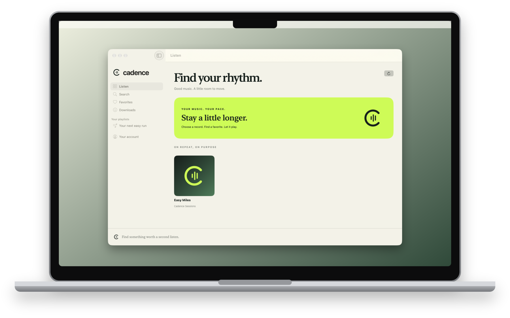
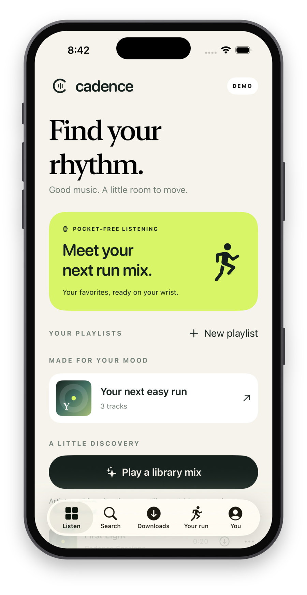
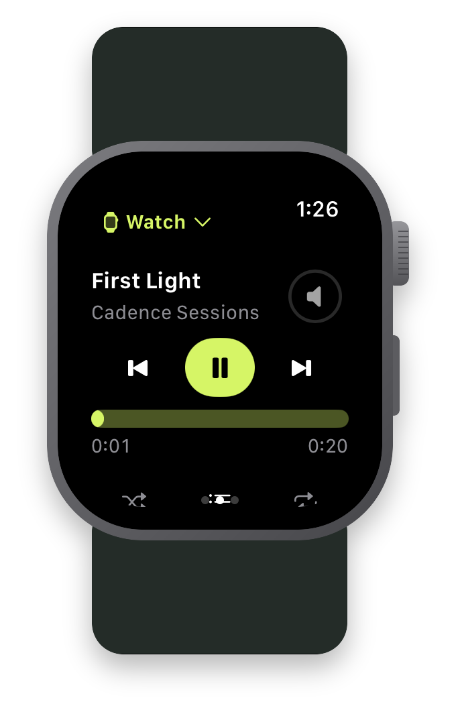

# Cadence

[](https://github.com/bahachammakhi/cadence-music/actions/workflows/ci.yml)
[](https://github.com/bahachammakhi/cadence-music/releases/latest)
[](LICENSE)


Your music on iPhone and Mac. Your running soundtrack on Apple Watch.

[Visit the Cadence website](https://bahachammakhi.github.io/cadence-music/) · [Download for Mac](https://github.com/bahachammakhi/cadence-music/releases/latest) · [Build from source](docs/BUILDING.md)

Cadence is a native SwiftUI client for a music server you control. It focuses on Aurral: browse and play your library, search a wider catalog, import Spotify playlists, and prepare offline playlists for Apple Watch.

The source is MIT licensed. There is no subscription or paid API built into Cadence. **You bring your own server and music sources.** A catalog search result is metadata, not a guarantee that full audio is available. Cadence does not provide a free Spotify catalog, hosted accounts or a music service.



<p>
  
  
</p>

*Screenshots are shown in generic device frames. Mac/phone images show earlier demos; the Watch image shows the 0.7.4 simulator player with original demo audio. Simulator imagery does not establish physical-device acceptance.*

## Get Cadence

| Platform | Available now | Requirements |
|---|---|---|
| Mac | [Download 0.7.2 (18)](https://github.com/bahachammakhi/cadence-music/releases/download/v0.7.2/Cadence-Mac-0.7.2-18.zip) · [SHA-256 checksum](https://github.com/bahachammakhi/cadence-music/releases/download/v0.7.2/Cadence-Mac-0.7.2-18.zip.sha256) | macOS 14+, Apple Silicon or Intel |
| iPhone + Apple Watch | [Build from source](docs/BUILDING.md), or use an existing private beta invitation | iOS 18+ and watchOS 10+ |
| Latest source | **0.7.5 (21)** on `main` · [Changelog](CHANGELOG.md) | Mac with full Xcode and XcodeGen |

The Mac download is Developer ID signed and Apple-notarized. Unzip, drag **Cadence.app** into **Applications**, and open it. Choose **Explore demo** or enter your own Server URL/account. The archive includes the MIT license and asset notices.

**The latest source is newer than the public Mac download.** Source 0.7.5 adds the recent Watch navigation, Crown volume, accessibility and wake/playback recovery improvements. Build from `main` to try them; the 0.7.2 Mac ZIP does not include these later source changes.

No public TestFlight join link is published here. The last [public review-status record](docs/releases/0.7.2-testflight.json), dated **8 November 2026**, records 0.7.2 (18) waiting for external review; it does not establish the status of newer private builds. Physical Watch acceptance remains pending. See [verification and known gaps](docs/QA.md).

Server URL starts blank on iPhone and Mac. When moving from a development-signed Mac build, macOS may ask for Keychain access to its saved login. Review that system prompt yourself; do not delete your credentials or disable security protections.

[Report a bug](https://github.com/bahachammakhi/cadence-music/issues/new/choose) · [Report a vulnerability privately](https://github.com/bahachammakhi/cadence-music/security/advisories/new)

## Try the demo

Build and run the **CadenceMac** scheme, then select **Explore demo**. Browse the sample library, play a clip and try the queue before connecting a server. No account, server, signing credentials or third-party music is needed for the demo's three original instrumental clips.

```sh
git clone https://github.com/bahachammakhi/cadence-music.git
cd cadence-music
brew install xcodegen
xcodegen generate
xcodebuild -project Cadence.xcodeproj -scheme CadenceMac \
  -destination 'generic/platform=macOS' -derivedDataPath .build/Mac \
  CODE_SIGNING_ALLOWED=NO build
open .build/Mac/Build/Products/Debug/Cadence.app
```

A Mac with full Xcode selected is required (last verified with **Xcode 27.2**); Command Line Tools alone are insufficient. This unsigned build is for local development. See [building](docs/BUILDING.md) for iPhone/Watch, simulator tests and signing a fork.

For your own library, enter your **HTTPS Aurral URL, username and password** at sign-in. No server address or shared credentials are supplied. If the server is private to Tailscale, connect that device to your tailnet first. [Setup and first listen](docs/SETUP.md).

## Features

- Native iPhone, macOS and companion Apple Watch apps; original cream, ink and lime interface.
- **All music** song/artist/album metadata search, plus paged **My library** search.
- Album and song playback, queue edits, shuffle, repeat-one/all, resume, next-item preparation and bounded playback retry.
- Favorites, editable server playlists and Spotify playlist import with visible preparation progress.
- Account-scoped preparation journal for missing audio; accepted jobs run on Aurral. Uncertain requests are checked before retrying.
- Discover feeds, recently played, artist follows and local listening-based library mixes.
- iPhone/Mac downloads, system Now Playing and media controls; Space toggles Mac playback outside text fields and dialogs.
- Private iPhone/Mac queue handoff and Watch remote control over Tailscale.
- Up to 10 offline Watch playlists, 100 tracks each, with verified transfer receipts and shared-file reuse.
- Watch device chooser, compact playback controls, local queue/seek screens, offline readiness and paused-session resume.
- Crown volume, a minimal Always On layout, native iPhone audio-launch routing and accessible control actions.

## Latest Watch improvements

Source 0.7.3–0.7.5 adds a device chooser, queue editing and seeking, offline readiness, Crown volume and a minimal Always On player. The latest fixes restore controls on wrist wake, retain the player through dimming and prevent automatic iPhone audio activity from interrupting active Watch playback. Explicit device selection still switches playback.

The 0.7.5 suite passed 17 UI cases on each of the 40 mm and 46 mm Watch simulators. The follow-up compiler fix passed the five affected cases again. Real Watch background playback, Bluetooth, phone-off runs and battery behavior still need hardware acceptance. [Watch controls and accessibility](docs/WATCH-ACCESSIBILITY.md) · [Detailed test evidence](docs/QA.md).

## Supported servers and services

**Cadence is an Aurral client with partial Subsonic compatibility.** Aurral is the tested server path; connecting another Subsonic-compatible server does not provide Aurral's native features.

| Server or service | What works |
|---|---|
| **Aurral** | Tested library playback, Discover, playlist imports and audio preparation; availability depends on server permissions and configured sources |
| **Other Subsonic-compatible servers** | Basic library browsing and playback may work; compatibility is unverified and not guaranteed. Aurral-specific Discover, imports and preparation require Aurral |
| **Spotify** | Playlist metadata/import through Aurral; no direct Spotify audio streaming |
| **Apple Music / iTunes catalog** | Public metadata search; no Apple Music subscription playback or account integration |
| **Demo mode** | Bundled original music and sample library; no server or account required |

See [server compatibility and test coverage](docs/COMPATIBILITY.md) for the exact verified versions and [setup](docs/SETUP.md) for connection requirements.

## Compatibility and limits

| Area | Current scope |
|---|---|
| Platforms | iOS 18+, watchOS 10+, macOS 14+; Mac Apple Silicon and Intel targets |
| Server | API v1 (Aurral 2.12.0) and consumed API v2 routes (upstream `743b57d`), plus Subsonic; v2 support starts with Cadence 0.7.2 |
| Newer Aurral | API v2 baseline, Discover playlists and renamed import fields are covered; optional providers still depend on server configuration |
| Other Subsonic servers | Basic routes may work, but full compatibility is not claimed |
| Global metadata | Apple public Search API, US catalog, up to 200 results per lookup/search |
| Full audio | Your Aurral library/sources; preparation can take time, require review or fail |
| Spotify | Playlist metadata/import through Aurral; not Spotify audio streaming; server-side Spotify connection may be required |
| Handoff | One Mac and paired iPhone; receiving/controlling iPhone must be foreground; no remote wake |
| Watch | Offline design implemented; physical background/Bluetooth/phone-off run acceptance remains pending |
| Recommendations | Aurral Discover plus local library ranking; no cloud-synced listening profile |
| Distribution | Public signed/notarized Mac ZIP; iPhone/Watch source builds or private beta; no public TestFlight link |

Free, instant, reliable access to every mainstream recording is not something this client can supply. Its license covers the code and original bundled assets, not rights to recordings or external services.

## Documentation

- [Setup, playback and Spotify imports](docs/SETUP.md)
- [Supported servers, services and compatibility evidence](docs/COMPATIBILITY.md)
- [Build and test from source](docs/BUILDING.md)
- [Landing page development and publishing](docs/LANDING-PAGE.md)
- [Product scope and roadmap](docs/PRODUCT.md)
- [Listening, preparation and Watch playlists](docs/LISTENING-AND-WATCH.md)
- [Watch controls, accessibility and device checks](docs/WATCH-ACCESSIBILITY.md)
- [Private Mac control and handoff](docs/MAC-CONTROL.md)
- [Architecture](docs/ARCHITECTURE.md) · [Privacy](docs/PRIVACY.md)
- [Testing and known verification gaps](docs/QA.md)
- [Release process](docs/RELEASE.md) · [Changelog](CHANGELOG.md)
- [Contributing](CONTRIBUTING.md) · [Security](SECURITY.md) · [Asset notices](THIRD_PARTY_NOTICES.md)
- [Public-release readiness](docs/OPEN-SOURCE-READINESS.md)

## Development

```sh
swift test --package-path Packages/CadenceCore
python3 -m unittest discover -s Scripts/tests -v
```

`project.yml` is the XcodeGen source of truth. `Packages/CadenceCore` contains shared models, network contracts, queue/storage logic and fixture tests. `Shared` holds app-level playback, discovery and preparation. `Apps` contains each platform's views and integration. No third-party Swift packages are required.

Contributions are welcome under [MIT](LICENSE). This is an early project; please report reproducible problems and distinguish simulator results from physical-device tests.
