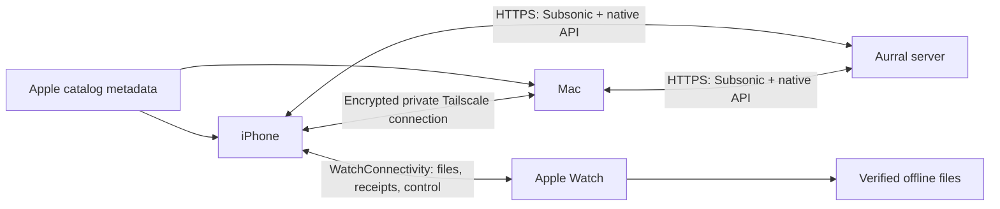

# Architecture

Cadence has three native clients, one shared Swift package and no hosted Cadence backend. Aurral is separately deployed and maintained by the server owner.

## Code map

| Path | Responsibility |
|---|---|
| `Apps/iOS` | Phone store, views, Keychain, background downloads and Mac client |
| `Apps/macOS` | Mac store, views, downloads, keyboard handling and Mac server adapter |
| `Apps/Watch` | Watch views, playback and transfer integration |
| `Shared` | AudioController, preparation/discovery state, local library, listening history and shared UI |
| `Packages/CadenceCore` | Models, Subsonic/native API clients, catalog contracts, queue/handoff, encrypted transport and durable data formats |
| `Tests` | App unit, native Mac and demo UI tests |
| `Resources` | Privacy manifest, original branding and original demo audio |
| `Scripts` | Asset generation, App Store Connect and release helpers |
| `project.yml` | XcodeGen project definition; generated project is checked in |

## Playback and missing audio

Subsonic endpoints provide available library songs, playlists, favorites and streams. All music queries Apple's public US catalog for metadata only. PreparationCenter resolves a matching library song or asks Aurral's native API to prepare it, then applies an explicit playback/queue/favorite/playlist/download intention.

The account-scoped journal is persisted before submission. Ambiguous responses become unconfirmed checks instead of automatic duplicate mutations. Relaunch never silently resumes an old playback intention. Account/generation checks reject late callbacks. Accepted acquisition belongs to Aurral and may continue when Cadence exits. Source selection, provider credentials, provider failures and acquisition rights belong to the server configuration.

AudioController manages actual playback, persistent queues, repeat, autoplay, bounded recovery and system metadata. Next-item preparation reduces waiting; it is not a promise of gapless streaming. ListeningProfile retains local history/follows/bookmarks and influences available-library ranking without a recommendation service.

## Watch storage

iPhone downloads verified files and transfers them using WatchConnectivity. The Watch validates saved files and returns receipts; a scheduled transfer is never presented as ready. The library supports multiple manifests with account barriers, shared file references, deletion tombstones and backward-compatible migration. No server credentials are sent to Watch.

OS scheduling controls background transfers. Offline playback and background audio are implemented, but physical Watch Bluetooth, wrist-down and phone-off acceptance are not yet certified. See [Watch details](LISTENING-AND-WATCH.md).

## Device handoff

The Mac's in-process server binds only its Tailscale IPv4 address on port 47823, with no wildcard or public fallback. Nearby Bonjour helps setup; cached/manual private endpoints work without discovery. CryptoKit ChaChaPoly encrypts bounded frames with account-derived keys, freshness and duplicate-command checks. This is a custom private transport, not Spotify Connect or an independently audited protocol.

The iPhone mediates Watch-to-Mac commands. Handoff exchanges queue and position, not audio files. Each receiver resolves its own library stream or download. Foreground iPhone availability, acknowledgments and generation barriers keep stale requests from replacing newer playback. See [protocol and constraints](MAC-CONTROL.md).

## Integration compatibility

The client retains API v1 support (Aurral 2.12.0) and supports the consumed API v2 routes verified against upstream commit `743b57d`. Bootstrap v1 requires the discover capability; v2 includes it in the baseline, even with an empty feature array. Discover refresh renegotiates the contract. Version 2 uses the provider-specific playlist routes and static playlist status field names; Subsonic playlist IDs remain `shared:`. Unknown future versions and malformed contracts are rejected. See [compatibility evidence](COMPATIBILITY.md). Subsonic-only support is an unverified subset, not an advertised equivalent product.

The native clients have no third-party Swift packages, cloud account system, push server or Cadence analytics backend. The separate static landing page uses PostHog cookieless website analytics; see [landing page development](LANDING-PAGE.md). [Privacy](PRIVACY.md) describes where data goes.
